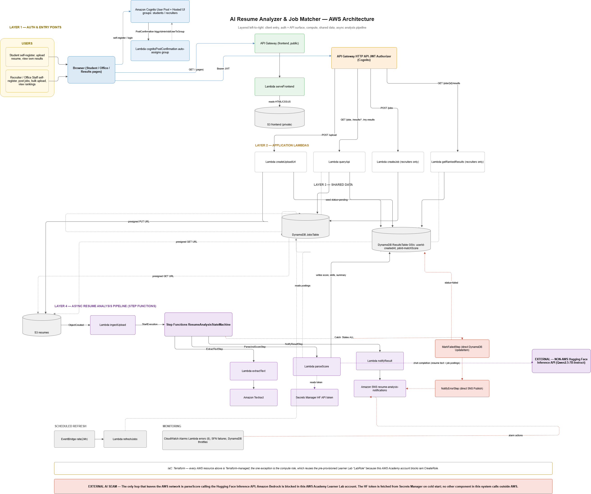

# AI Resume Analyzer & Job Matcher

A serverless, AI-powered resume screening platform built on AWS with Terraform IaC. Students upload a resume and get an instant AI-generated match score and feedback; recruiters post jobs and review AI-ranked candidates with charts and analytics.

[](https://github.com/Dhruti832/resume-analyzer/actions/workflows/deploy.yml)


## Highlights

- **Fully serverless AWS architecture**: 11 Lambda functions behind API Gateway with Cognito JWT auth, plus a Step Functions pipeline that extracts, scores and reports on each upload
- **Real AI integration** — resumes are OCR'd with Amazon Textract, then scored and summarized by an LLM (Qwen2.5-7B-Instruct via Hugging Face Inference API)
- **Two-role product**: a student portal (upload, track, review feedback) and a recruiter portal (post jobs, bulk-upload, ranked results with charts)
- **Infrastructure as Code** — the entire stack (Cognito, DynamoDB, S3, Step Functions, IAM, alarms) is defined in Terraform and deployed via GitHub Actions CI/CD
- **Tested and monitored** — 71 unit tests mocking every AWS SDK call, plus 10 CloudWatch alarms across Lambdas, Step Functions, and DynamoDB
- **Security-conscious** — least-privilege IAM, Secrets Manager for API keys, ownership checks on every read, HSTS/CSP/X-Frame-Options on all responses

## Architecture



```
Student/Recruiter Browser
        │
        ▼
API Gateway (HTTP API) ──JWT authorizer──▶ Cognito User Pool
        │                                  (students / recruiters groups)
   ┌────┴────────────────────────────────────────────┐
   │  POST /upload     GET /jobs    POST /jobs        │
   │  GET /results     GET /my-results                │
   │  GET /jobs/{id}/results                          │
   └────┬────────────────────────────────────────────┘
        │
   Lambda Functions
        │
        ├─ createUploadUrl ──▶ S3 presigned PUT URL ──▶ Resume S3 Bucket
        │                       (seeds ResultsTable: status=pending)
        │
        ├─ S3 Event ──▶ ingestUpload ──▶ Step Functions State Machine
        │                                       │
        │                         ┌─────────────┼─────────────┐
        │                    ExtractText    ParseAndScore  NotifyResult
        │                    (Textract)   (HF LLM via     (SNS email)
        │                                Secrets Manager)
        │                         │
        │                    MarkFailedStep (DynamoDB SDK) ──▶ NotifyErrorStep (SNS)
        │                    [on any error]
        │
        ├─ queryApi ──▶ DynamoDB ResultsTable / JobsTable (also mints presigned S3 GET URLs)
        ├─ getRankedResults ──▶ DynamoDB GSI (jobId-matchScore-index, sorted desc)
        ├─ createJob ──▶ DynamoDB JobsTable
        └─ EventBridge (rate: 24h) ──▶ refreshJobs ──▶ DynamoDB JobsTable

DynamoDB ResultsTable: PK=candidateId, SK=resumeId
  GSIs: userId-createdAt-index (student history), jobId-matchScore-index (recruiter ranking)

Monitoring: CloudWatch alarms on the 8 core Lambdas + Step Functions failures + DynamoDB throttles
```

The frontend is served via a dedicated Lambda (`serveFrontend`) reading from a private S3 bucket
through API Gateway — CloudFront is not available in AWS Academy Learner Lab.

Full sequence diagrams for registration, upload/analysis, job posting, and the refresh job are in
[`docxs/diagrams`](docxs/diagrams).

## Features

**Student portal**
- Upload resume as PDF against any posted job or paste a custom job description
- Real-time analysis progress stepper (Upload → Textract → AI Scoring → Complete)
- History tab showing all past analyses with status (pending / completed / failed)
- Per-analysis: match score, matched skills, strengths, gaps, and improvement recommendations
- Resume PDF download

**Recruiter portal**
- Post job openings with required skills and location
- Drag-and-drop bulk resume upload (multiple PDFs at once)
- Ranked candidates page with:
  - Stat cards (total applicants, average score, top score, strong matches ≥70)
  - Score distribution bar chart + top skills frequency chart (Chart.js)
  - Ranked table with score pill, mini progress bar, skills, summary, and resume PDF download

**Infrastructure**
- Cognito-backed auth with Post-Confirmation Lambda for automatic group assignment
- Step Functions error handling: failed analyses update DynamoDB (`status=failed`) and send SNS alert
- S3 lifecycle: 30-day noncurrent version expiry, 7-day incomplete multipart cleanup
- API Gateway throttling: 100 rps / 50 burst
- HF API token stored in AWS Secrets Manager (never in code or IaC)
- Security headers on all frontend responses (HSTS, X-Frame-Options, CSP)

## Tech Stack

| Category | Services |
|---|---|
| Compute | AWS Lambda (Node.js 20.x) |
| Orchestration | AWS Step Functions (Standard Workflows) |
| API | Amazon API Gateway (HTTP API, JWT authorizer) |
| Storage | Amazon S3 (resumes + frontend), Amazon DynamoDB |
| AI/ML | Amazon Textract, Hugging Face Inference API (Qwen/Qwen2.5-7B-Instruct) |
| Auth | Amazon Cognito (User Pool, Hosted UI, groups) |
| Messaging | Amazon SNS |
| Scheduling | Amazon EventBridge (24h rule seeds baseline job postings) |
| Secrets | AWS Secrets Manager |
| Monitoring | Amazon CloudWatch (10 metric alarms) |
| IaC / CI | Terraform, GitHub Actions |
| Frontend | Vanilla JS, Chart.js |
| Testing | Jest, aws-sdk-client-mock |

## API Endpoints

All routes require `Authorization: Bearer <cognito-id-token>`.

| Method | Path | Role | Description |
|---|---|---|---|
| POST | /upload | any | Presigned S3 PUT URL; seeds `status=pending` in ResultsTable |
| GET | /jobs | any | List all public job postings |
| POST | /jobs | recruiters | Create a job posting |
| GET | /results/{candidateId} | owner only | Get analysis result (403 if not owner) |
| GET | /my-results | students | Paginated history with job details and download URLs |
| GET | /jobs/{jobId}/results | recruiters | Ranked candidates for a job (ownership enforced) |

Pagination: `?limit=N&nextToken=<base64url>` on `/my-results` and `/jobs/{jobId}/results`.

## Running Tests

```bash
npm install
npm test
```

Tests use [aws-sdk-client-mock](https://github.com/m-radzikowski/aws-sdk-client-mock) to mock
all AWS SDK calls — no AWS credentials needed.

```
Test Suites: 6 passed
Tests:       71 passed
```

## Deploy

### Prerequisites

- Terraform ≥ 1.9
- AWS CLI with Learner Lab credentials
- `infra/terraform.tfvars` (gitignored):

```hcl
demo_user_password = "YourPassword123!"
notification_email = "you@example.com"   # optional — SNS alert recipient
hf_token           = "hf_..."            # Hugging Face API token
```

### Steps

```bash
cd infra
terraform init
terraform apply -auto-approve
```

> **AWS Academy Learner Lab:** credentials expire every ~4 hours.
> Update `AWS_ACCESS_KEY_ID`, `AWS_SECRET_ACCESS_KEY`, and `AWS_SESSION_TOKEN`
> in GitHub repository secrets before each CI deploy.

### Demo accounts

Two Terraform-managed accounts are created automatically:

| Role | Email | Password |
|---|---|---|
| Student | student1@test.com | `demo_user_password` from tfvars |
| Recruiter | recruiter1@test.com | `demo_user_password` from tfvars |

## CI/CD

GitHub Actions runs on every push to `main`:

1. **Unit tests** — `npm test` must pass before deploy starts
2. **Terraform apply** — deploys infra and Lambda code changes to AWS

Secrets required in GitHub repository settings:
`AWS_ACCESS_KEY_ID`, `AWS_SECRET_ACCESS_KEY`, `AWS_SESSION_TOKEN`,
`DEMO_USER_PASSWORD`, `HF_TOKEN`

## Project Structure

```
lambdas/     11 Lambda function handlers (Node.js)
infra/       Terraform IaC (API Gateway, Cognito, DynamoDB, S3, Step Functions, alarms)
frontend/    Static HTML/JS/CSS served through API Gateway
tests/       Jest unit tests (mocked AWS SDK)
docxs/       Project documentation, diagrams, and reports
```

## Documentation

Detailed docs — Software Requirements Specification, System Design Document, AWS Deployment
Guide, Testing Report, User Manual, and architecture/sequence diagrams — are in
[`docxs/`](docxs).

## License

MIT — see [LICENSE](LICENSE).

## Author

Built by [Dhruti Patel](https://github.com/Dhruti832).
